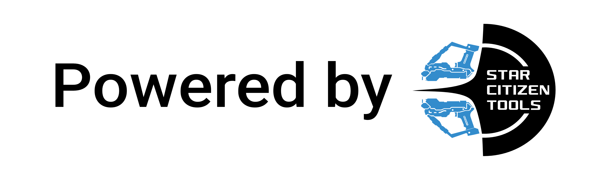

  

<h1 align="center">Starlight</h1>

The solution for your trading and general knowledge needs.

  
  
  and its <a href="https://api.star-citizen.wiki">API</a>

  

## What is Starlight?

Starlight is primarily a discord bot built on Typescript and Bun that focuses on providing a broad range of information from the comfort of you and your groups' discord server.

Starlight aims to make fetching general info during conversation or as needed quick and painless, showing you the important stuff first and linking to our sources for your continued / further reading.

## Planned Features

- Ships
  - [ ] Vehicle Loaners
  - [ ] Vehicle stats
  - [ ] Vehicle Purchase info (ingame & store)
  - [ ] Vehicle stats and equipment
  - [ ] Vehicle Lore
- Commodities & Trading
  - [ ] Alerts, Prices & Price history from UEX
  - [ ] Trade routes from UEX
  - [ ] 15 day average prices for a commodity from UEX
- Items, Gear & Equipment
  - [ ] lore and general information
